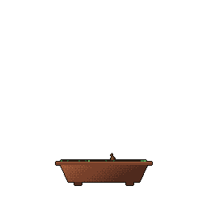

### :lion: Hi I'm Leo

Learn more about me on my website :)

<!--
### :balloon: Experiences
- **Software Engineer @ Improving** > Building software for businesses.
- **Software Developer @ BonAppawtite** > Developing automation tools and services for a local business.
- **Software Engineer @ Voronoi Health Analytics** > Backend development on our flagship software.
- **Game Developer @ UBC Game Development Club** > Full-stack development on the UI/UX programming team.

### :seedling: Hobbies
- Coffee :coffee:
- Ultimate Frisbee :white_circle:
- Streaming and Content Creation :film_projector:

### :eyes: What's going on
- Looking for an SWE Position
-->

### Development

### Languages & Frameworks

### Other

   
  

<!--
### :envelope: Contact
You can reach me via email here: leowangmessages@gmail.com

-->
